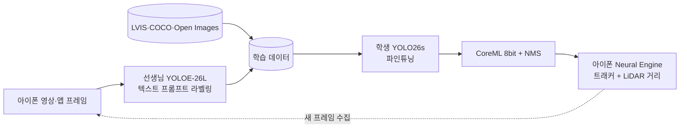

<!-- Header -->

 

<!-- 커밋할수록 동물이 생기고 자라는 GitAnimals 농장 -->

  

<!-- 잔디를 먹는 뱀 (.github/workflows/snake.yml 필요) -->
<picture>
  <source media="(prefers-color-scheme: dark)" srcset="https://raw.githubusercontent.com/broBbang2/broBbang2/output/github-snake-dark.svg" />
  
</picture>

 

## 👋 About Me

안녕하세요, **데이터에서 모델, 그리고 실제 기기까지** 직접 만드는 ML 개발자 **김민식**입니다.
웹·앱 서비스를 만들며 AI 기능을 제품에 붙여 왔고, 지금은 데이터 수집부터 라벨링 · 학습 · 온디바이스 배포까지 모델을 직접 만드는 일에 집중하고 있습니다.

- 🧪 baseline에서 한 번에 하나씩 바꿔 비교하고, train/val 누수처럼 점수를 부풀리는 요인부터 막습니다
- 🔍 데이터 양 · 모델 크기를 바꿔 보며 "용량이 아니라 데이터가 병목"임을 실험으로 확인하는 식으로 원인을 좁힙니다
- 📱 모델을 실제 앱·키오스크·운영 파이프라인에 붙여 보며 지연 시간, 모델 크기, 무인 운영과 장애 복구까지 서비스 관점에서 함께 설계합니다

 

## 🧠 ML Projects

<table>
<tr>
<td width="100%">

### 📷 [MSCV](https://github.com/broBbang2/MSCV) — 아이폰 온디바이스 실시간 사물 인식
> 데이터 0장에서 시작해 수집 → 자동 라벨링 → 학습 → CoreML 배포 → 재학습까지, 객체 탐지 파이프라인 전체를 직접 구축

  

- **지식 증류 구조** — 아이폰에서 못 도는 큰 모델(YOLOE)은 라벨을 만드는 선생님으로, 약 1천만 파라미터의 YOLO26s를 배포용 학생으로
- **프롬프트 채점으로 라벨 품질 개선** — 클래스별 이름 조합을 사람 라벨 300장으로 채점해 선생님 AP50 **0.59 → 0.65** (monitor **0.22 → 0.83**)
- **누수 없는 평가** — train/val을 프레임이 아닌 **영상 단위**로 분리해 이웃 프레임으로 점수가 부풀려지는 것을 차단
- **온디바이스 최적화** — CoreML 8비트 양자화 + NMS 내장으로 **18MB → 9.3MB**, iPhone 16 Pro Max에서 **추론 16ms**
- **자동 재학습 루프** — 앱이 모은 프레임 → 라벨 → 학습 → 기존 모델과 비교 → 더 나으면 아이폰에 자동 설치

**실험으로 찾은 병목** (같은 검증 세트, 10클래스 mAP50)

| 시도 | mAP50 | 알게 된 것 |
|---|---:|---|
| 내 영상만으로 학습 (YOLO26n) | 0.412 | 기준선 |
| + 공개 데이터 수천 장 | 0.404 → 0.413 | 정지 사진과 들고 찍은 영상의 **도메인 차이** |
| 모델 크기 n → s | **0.442** | 오르지만 폭이 작고 검증 손실 정체 → **용량보다 데이터가 병목** |

> 🚧 **다음 단계** — 속도 · 크기 목표는 달성했고 정확도는 목표(0.7)의 약 60%입니다. 지금 점수는 선생님 라벨 기준이라, 사람이 검수한 시험 세트로 "실제 정답률"을 재고 라벨 품질 · 장면 다양성 · 모션 블러 순으로 개선하고 있습니다.

`Python` `PyTorch` `Ultralytics YOLO` `YOLOE` `CoreML` `Swift` `Vision`

</td>
</tr>
</table>

<table>
<tr>
<td width="100%">

### ⚫ [Let's learn Go](https://github.com/broBbang2/Let-s-learn-Go) — 나와 같이 성장하는 적응형 바둑 AI
> 너무 강해서 재미없는 바둑 AI 대신, 내 실력을 **수 단위로 추정**하고 그 급수 사람이 둘 법한 **사람 같은 실수**를 하는 상대

- KataGo를 두뇌로 쓰고, 그 위에 **사용자 모델 + 난이도 조절** 두 층을 직접 설계
- 매 수마다 베이즈 갱신으로 20급~9단 급수 추정 — **20수 만에 89%가 ±1급 이내**
- 손실 크기만 맞추던 v2(사람 top-3 일치 **9~30%**)를 human 모델 기반 v3로 바꿔 **70~78%**
- 판 결과로 보정 계수를 갱신해 사용자 승률 **45%** 근처로 수렴
- 급수 순서를 뒤집던 평가 지표를 접전 국면 기준으로 재정의, 리그전 판당 **90초 → 59초**
- 가짜 KataGo로 엔진 없이 도는 **테스트 98개**

`Python` `KataGo` `Bayesian Inference` `Glicko-2`

</td>
</tr>
</table>

<b>🎨 <a href="https://github.com/broBbang2/Personal-Color">Personal-Color</a></b> — 퍼스널 컬러 분류 모델

 

- AI·빅데이터 공부를 시작하며 만든 첫 분류 모델 프로젝트

 

## 🏭 Applied AI in Production

<b>👥 CCTV 유동인구 분석</b> — <code>YOLO26n-seg</code> <code>SAM 3.1</code> <code>GCP</code>

 

- 30초 간격 매장 CCTV 스냅샷 **71,650장**을 분석해 시간대별 인원을 집계하는 파이프라인 구축
- 빠른 **YOLO 게이트 → SAM 3.1 확정**의 2단계 탐지로 비용과 정확도를 함께 확보
- 탐지 → 집계 → 구글 시트 업로드를 매일 새벽 자동 실행, 무인 매장 수집기는 재부팅·정전 후 스스로 복구
- 카메라 화각 변경 후 확정률이 **96~99% → 39~70%** 로 떨어진 것을 찾아내 과소 집계 구간을 분리하고 신뢰 구간을 명시

<b>⚙️ 댄스 영상 자동화 파이프라인</b> — <code>SAM 3</code> <code>CUDA</code> <code>CuPy</code>

 

- 곡 목록만 넣으면 수집 → 인원 필터 → 난이도 보정 → 캐릭터 합성 → 4K 업스케일 → SAM 3 추적 누끼 → 업로드·검증까지 자동 처리
- 렌더링 픽셀 연산을 GPU(CuPy)로 옮기고, 곡별 실패(추적 유실 등)를 격리해 실패한 곡만 재처리

<b>🎬 AI 댄스 영상 생성 키오스크</b> — 생성 모델 서빙 최적화

 

- 해상도 · fps · 길이 · 품질 모드 **36가지 조합을 실측**해 생성 시간을 좌우하는 변수가 해상도임을 확인
- 화면 표시 크기에 맞춰 출력을 조정해 **프리뷰 대기 209초 → 97초 (54% 단축)**

 

## 💻 Product Engineering

웹 · 앱 서비스 개발 경험 펼쳐 보기

 

- **🕺 Sparky** (React Native) — K-pop 글로벌 댄스 앱의 퀘스트 · 순위 · 프로필 화면, 배너 노출 · 클릭 이벤트 수집 API
- **💃 댄스 스튜디오 예약·결제 웹** (Next.js 16 · Hono) — 커밋 845개, 사실상 단독 개발. 진행 방식별 요금 · 결제 · 권한 분리 관리자
- **🎙 음성 분석 서비스 마이그레이션** (React · Cloud Run) — 계산 엔진 분리, 원본 대조 테스트 211개로 동일성 검증
- **🍶 [Choice](https://github.com/broBbang2/give-me-recommend)** (Next.js · OpenAI API) — LLM 대화형 주류 추천, 태그 필터 쿼리 + GIN 인덱스로 **2,007ms → 262ms**

 

## 🛠 Tech Stack

**ML · Vision** 

Ultralytics YOLO · YOLOE · SAM 3.1 · CoreML · KataGo · CUDA / CuPy · OpenAI API

**Product · Infra** 

React Native · Hono · Vitest · Playwright

 

## 🎯 Now

- 📷 **MSCV** — 사람이 검수한 시험 세트로 "실제 정답률"을 재고, mAP50 0.44 → 0.7 끌어올리기
- 🏷 선생님 모델의 **라벨 노이즈**가 학생 모델의 성능 상한을 어떻게 제한하는지 실험하기
- 🌏 공개 데이터와 현장 데이터의 **도메인 차이**를 줄이는 방법(혼합 비율 · 2단계 학습 · 증강) 비교하기

